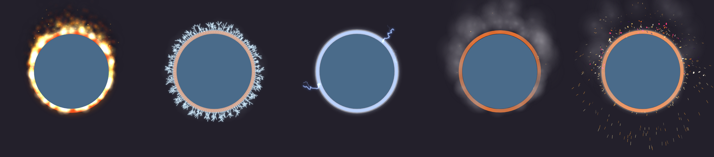
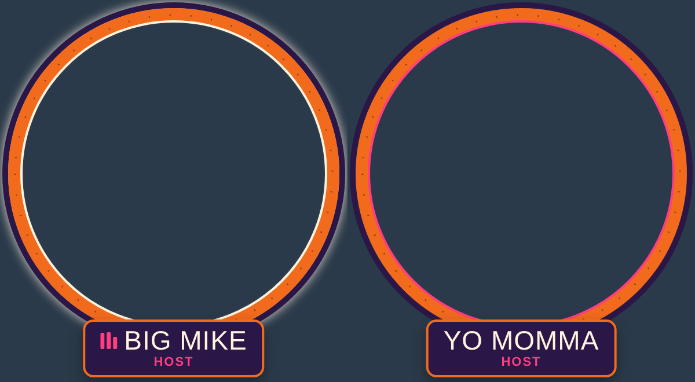
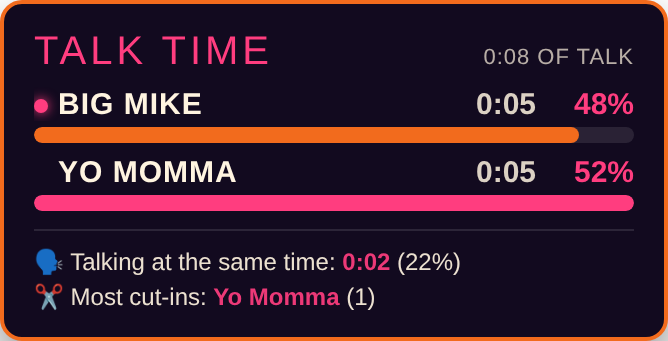

# Argue with Yo Momma! · OBS overlay kit

Everything the **Argue with Yo Momma!** basketball debate podcast uses to run its show in [OBS Studio](https://obsproject.com/): animated backgrounds, camera frames, lower thirds, a shot clock, NBA stats cards, a debate scoreboard, hot-take receipts, a sound board, frame effects, talk-time tracking, remote guests, hotkeys and ready-made stream-controller layouts.

It's all plain HTML, CSS and JavaScript (OBS browser sources and custom browser docks), plus one Lua setup script that builds the scenes for you. Nothing to install and no build step: download, unzip, open `START-HERE.html`.

## Quick start

1. **Download** this repository (green **Code** button → **Download ZIP**) and unzip it somewhere permanent, e.g. `Documents`.
2. **Open `START-HERE.html`** in your browser. It walks you through every step and gives you the exact addresses for your folder, ready to copy.
3. In OBS: **Tools → Scripts → +** → pick `awym-obs-setup.lua` → **Build my scenes**. You get Starting Soon, Main Show, Be Right Back, Technical Difficulties, Halftime and Thanks for Watching, with every overlay in place.
4. Add the docks (**Docks → Custom Browser Docks…**): Control Panel, Stats Desk, Theme Panel, Content Panel and Show Runner. START-HERE has the addresses.

Requirements: **OBS Studio 28 or newer** (30+ recommended) on Windows or macOS. An internet connection is only needed for web fonts, live NBA stats and remote guests.

## What's in it

| | |
|---|---|
| **Scenes and screens** | Starting Soon / Be Right Back / Halftime / Thanks for Watching screens with countdowns; 30+ animated backgrounds (court, arena, Tin Foil conspiracy board, vaporwave…). |
| **People** | Camera frames (circle, rounded, hexagon) with name plates and a "has the floor" spotlight; lower thirds; remote guests through [VDO.Ninja](https://vdo.ninja/). |
| **Shot clock** | Arena-style segment timer with buzzer and a Tin Foil alert. |
| **Stats Desk** | Live NBA scores, box scores, player lines, standings and a ticker (ESPN's public data). |
| **Show Runner** | Rundown with segment intros, debate scoreboard and winner, hot-take receipts, sound board, clips and instant replay, backups. |
| **Frame effects** | 🔥 fire, 🧊 ice, ⚡ lightning, 💨 smoke, ✨ sparks and 💥 shake around a camera frame. The camera itself is never covered. |
| **Talk time** | A speaking light on whoever's talking, talk time per person, time spent talking over each other, cut-ins, and an on-screen card. |
| **Mute** | One mute button per person (dock, hotkeys, stream deck) with a MUTED tag on their frame. |
| **Content Panel** | Rich on-screen text with photos and emojis, or **import a whole show script** from Google Docs / Word ([template](templates/)). |
| **Theme** | Colors, fonts and glow change live on every overlay; 80 color presets including all 30 NBA teams. |
| **Hotkeys** | 51 OBS hotkeys (Ctrl + Alt + Shift + …) with key pictures for stream controllers. |

  
  

## Stream controllers

Ready-made layouts in [`stream-controller/`](stream-controller/), all 51 actions with their pictures:

- **VSD M18** (VSD Craft): `VSD-M18/AWYM-Show.SDProfile` (5 pages) plus one-page Run of Show, Scoreboard, Frame FX and Sound Board scenes.
- **Elgato Stream Deck** 15-key (MK.2 / original), XL, Mini, Neo and +: `Elgato-Stream-Deck/*.streamDeckProfile`.
- Anything else (Mirabox/Ajazz Stream Dock, Loupedeck, Razer, Touch Portal, a macro pad): START-HERE step 10 has step-by-step instructions, and `icons/hotkeys/` has every key picture.

The Elgato profiles follow the Stream Deck app's V3 profile format but haven't been imported on every model yet. If one won't import, the manual steps in START-HERE work on any version.

## Folder guide

| Path | What it is |
|---|---|
| `START-HERE.html` | The setup guide (open this first) |
| `awym-obs-setup.lua` | OBS script: builds the scenes, adds the hotkeys, keeps frame effects lined up |
| `*.html` | Overlays (browser sources) and docks; each file's header comment explains it |
| `shared.js` | Shared helpers and the message protocol every page uses (documented at the top) |
| `README.txt` | The full manual |
| `stream-controller/` | VSD M18 and Elgato Stream Deck layouts |
| `icons/hotkeys/` | Key pictures, 144 × 144 PNG |
| `sounds/` | Drop your own sound files here to replace any sound; `sounds/kit/` holds the bundled recordings |
| `templates/` | Show-script template for writers (Word + Markdown) |
| `masks/` | Circle / rounded / hexagon camera masks |
| `lib/` | anime.js (animation library) |
| `tools/` | Scripts that rebuild the generated files (see [tools/README.md](tools/README.md)) |

## How it fits together

Every overlay and dock talks over a `BroadcastChannel` named `awym-control`, so docks control overlays live with no server. The Show Runner also connects to OBS's built-in WebSocket server for clips, replays, scene switching, mute and audio levels. The full list of messages is at the top of [`shared.js`](shared.js).

## Credits

Built for **Argue with Yo Momma!**. Third-party pieces and their licences are listed in [THIRD-PARTY-NOTICES.md](THIRD-PARTY-NOTICES.md).
