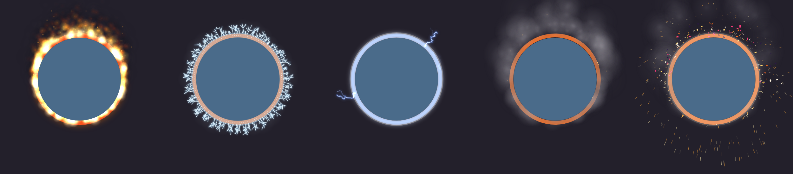
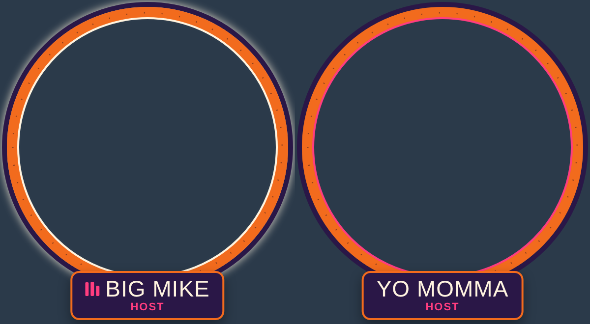
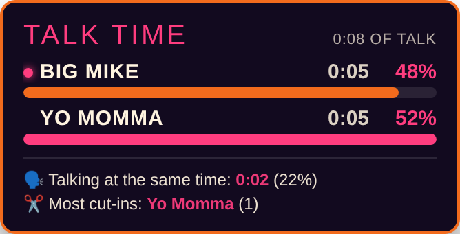
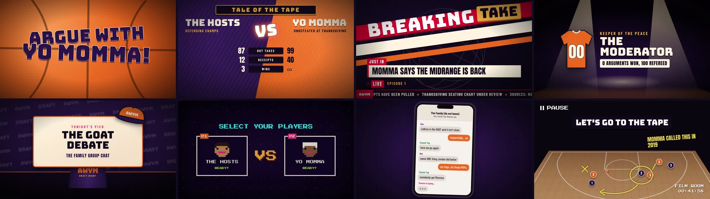
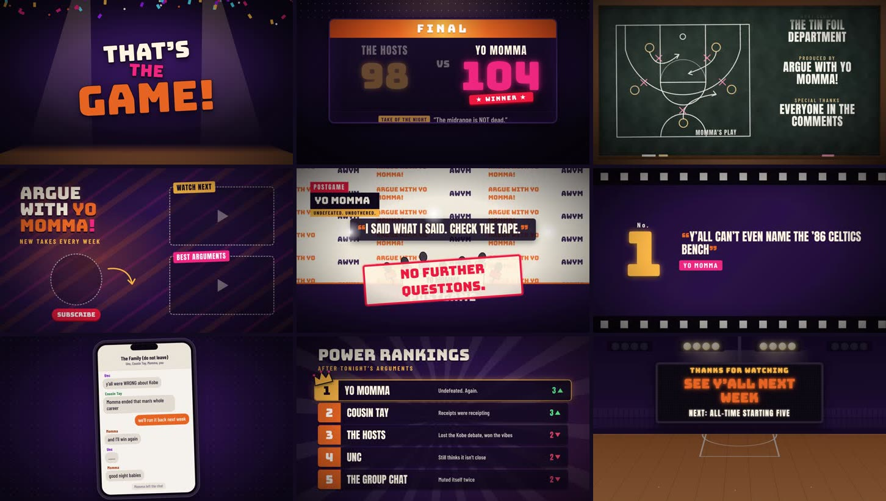

# Argue with Yo Momma! · OBS overlay kit

Everything the **Argue with Yo Momma!** basketball debate podcast uses to run its show in [OBS Studio](https://obsproject.com/): animated backgrounds, camera frames, lower thirds, nine show intros and nine outros, a shot clock with overtime, NBA stats cards, a debate scoreboard, hot-take receipts, a sound board, frame effects, talk-time tracking, remote guests, hotkeys and ready-made stream-controller layouts.

It's all plain HTML, CSS and JavaScript (OBS browser sources and custom browser docks), plus one Lua setup script that builds the scenes for you. Nothing to install and no build step: download, unzip, open `START-HERE.html`.

## Quick start

1. **Download** this repository (green **Code** button → **Download ZIP**) and unzip it somewhere permanent, e.g. `Documents`.
2. **Open `START-HERE.html`** in your browser. It walks you through every step and gives you the exact addresses for your folder, ready to copy.
3. In OBS: **Tools → Scripts → +** → pick `awym-obs-setup.lua` → **Build my scenes**. You get Starting Soon, Main Show, a scene for every layout (1–4 people, 2–5 + moderator), Be Right Back, Technical Difficulties, Halftime and Thanks for Watching, plus an **Intro** scene that plays the show intro and then switches to Main Show and an **Outro** scene that plays the outro, with every overlay in place. Each person's camera, avatar, frame and frame effects are grouped as **Seat N** and color-coded in the Sources list.
4. Add the docks (**Docks → Custom Browser Docks…**): Control Panel, Stats Desk, Theme Panel, Content Panel and Show Runner (plus the optional Intro Editor and Outro Editor). START-HERE has the addresses.

Requirements: **OBS Studio 28 or newer** (30+ recommended) on Windows or macOS. An internet connection is only needed for web fonts, live NBA stats and remote guests.

## What's in it

| | |
|---|---|
| **Scenes and screens** | Starting Soon / Be Right Back / Halftime / Thanks for Watching screens with countdowns; 40+ animated backgrounds (court, arena, Tin Foil conspiracy board, vaporwave… and light ones: daylight court, studio white, sports page, clear sky…). |
| **Show intros** | Nine to pick from in the Intro Editor dock, each with its own words and a live preview: **Classic** (the corners slam together, VS, a quick argument in speech bubbles, the title and four name plates; every color, font and speed adjustable), Tip-Off, Tale of the Tape, Breaking Take, Starting Lineup, Draft Night, Arcade Mode, Family Group Chat and Film Room. It plays when you switch to the Intro scene, then switches to Main Show. [More below.](#intros-and-outros) |
| **Outros** | Nine to pick from in the Outro Editor dock: Final Buzzer, Final Score, Chalk Talk Credits, Mic Drop End Screen (a YouTube end screen), Postgame Presser, Highlight Reel, Group Chat Wrap-Up, Power Rankings and Lights Out. It plays when you switch to the Outro scene, and can then switch to Thanks for Watching. |
| **Layouts** | Ready-made scenes for 1, 2, 3 or 4 people and 2–5 people + a moderator (the moderator a bit smaller), with color-coded groups per seat. |
| **People** | Camera frames (circle, rounded, hexagon) with name plates and a "has the floor" spotlight; lower thirds; remote guests through [VDO.Ninja](https://vdo.ninja/), with badge pictures and saved guests. |
| **Shot clock** | Arena-style segment timer with buzzer, a Tin Foil alert, and an **Overtime +1:00** button that turns the frame and numbers electric purple (2OT, 3OT…). |
| **Stats Desk** | Live NBA scores, box scores, player lines (season, last N games with an average, or a single game), standings and a ticker (ESPN's public data). |
| **Show Runner** | Rundown with segment intros, debate scoreboard and winner, hot-take receipts, sound board, clips and instant replay, backups. |
| **Frame effects** | 🔥 fire, 🧊 ice, ⚡ lightning, 💨 smoke, ✨ sparks and 💥 shake around a camera frame, plus ten verdicts (🗑️ trash take, 💯 100% facts, 👨‍🍳 cooking, 🧢 cap, 🧱 bricked, 🌬️ air ball, 🟥 technical foul, 💥 posterized, 🔥 on fire, 🤡 clown take), each with sliders for amount, size, speed and brightness. The camera itself is never covered. |
| **Talk time** | A speaking light on whoever's talking, talk time per person, time spent talking over each other, cut-ins, and an on-screen card. |
| **Mute** | One mute button per person (dock, hotkeys, stream deck) with a MUTED tag on their frame. |
| **Faces** | Swap a live camera for a set of prebuilt faces (cartoon you, reactions…), switched from the dock, hotkeys or a stream deck's Faces page; the face bobs along while you talk. |
| **Content Panel** | Rich on-screen text with photos and emojis, or **import a whole show script** from Google Docs / Word ([template](templates/)). |
| **Theme** | Colors, fonts and glow change live on every overlay; 80 color presets including all 30 NBA teams. |
| **Hotkeys** | 74 OBS hotkeys (Ctrl + Alt + Shift + …) with key pictures for stream controllers. |

  
  

## Intros and outros

| Intro | Length | What happens |
|---|---|---|
| Classic | 8–14 s | Corners slam together, VS, the argument in speech bubbles, title, name plates |
| Tip-Off | 9 s | A jump ball flies into the camera, the title slams in on a basketball |
| Tale of the Tape | 10 s | Fight-night matchup: two corners, stats, VS lightning |
| Breaking Take | 9 s | Sports-news BREAKING parody with a headline and ticker |
| Starting Lineup | 12 s | Spotlights and jerseys for up to four people |
| Draft Night | 10 s | "With the 1st pick in tonight's argument…" — tonight's topic gets drafted |
| Arcade Mode | 9 s | Insert coin, player select, pixel title, chiptune |
| Family Group Chat | 10 s | Texts pop in on a phone, then "Momma is typing…" |
| Film Room | 10 s | VHS play, rewind, pause and a telestrator: "Let's go to the tape" |

| Outro | Length | What happens |
|---|---|---|
| Final Buzzer | 12 s | Shot clock 0:05 → buzzer, "THAT'S THE GAME!", confetti, subscribe |
| Final Score | 14 s | Scoreboard, winner ribbon, take of the night, next episode |
| Chalk Talk Credits | 16 s | A chalkboard play draws itself while the credits roll |
| Mic Drop End Screen | 20 s | Mic drop, then a YouTube end screen with spots for two videos and Subscribe |
| Postgame Presser | 13 s | Podium, camera flashes, a closing quote, "No further questions." |
| Highlight Reel | 15 s | Countdown of the night's top takes |
| Group Chat Wrap-Up | 12 s | The family reacts in texts, then "Momma left the chat" |
| Power Rankings | 13 s | Names shuffle into tonight's order; #1 gets the crown |
| Lights Out | 12 s | The arena lights shut off, a broom sweeps, the scoreboard signs off |

- **Your words, live.** Names, scores, topics, credits and chat messages are set in the Intro Editor and Outro Editor docks with a live preview, and go straight to OBS. The Guests page's "Send names" fills Tale of the Tape, Arcade Mode and Starting Lineup; the Outro Editor's **Fill from receipts** puts the Show Runner's last five takes in the Highlight Reel.
- **Made with [HyperFrames](https://github.com/heygen-com/hyperframes).** Each intro and outro (except Classic) is a HyperFrames composition: plain HTML, CSS and [GSAP](https://gsap.com). In OBS they play live through `outros/player.js`, so nothing extra is needed. To make an **MP4** (for YouTube, say), download the HyperFrames projects from the [release](../../releases/latest) and run the command the editor's **Copy command** button gives you (needs Node.js 22+ and FFmpeg).
- **No samples, nothing to license.** Every sound effect and the beat are made in code; the fonts (Bungee, Anton, Barlow Condensed, Press Start 2P) are under the SIL Open Font License and ship in `outros/assets/fonts/`, so they work offline.

## Stream controllers

Ready-made layouts in [`stream-controller/`](stream-controller/), all 74 actions with their pictures:

- **VSD M18** (VSD Craft): `VSD-M18/AWYM-Show.SDProfile`, one file with everything on 7 pages.
- **Elgato Stream Deck** 15-key (MK.2 / original), XL, Mini, Neo and +: `Elgato-Stream-Deck/*.streamDeckProfile`.
- Anything else (Mirabox/Ajazz Stream Dock, Loupedeck, Razer, Touch Portal, a macro pad): START-HERE step 10 has step-by-step instructions, and `icons/hotkeys/` has every key picture.

The Elgato profiles follow the Stream Deck app's V3 profile format but haven't been imported on every model yet. If one won't import, the manual steps in START-HERE work on any version.

## Folder guide

| Path | What it is |
|---|---|
| `START-HERE.html` | The setup guide (open this first) |
| `awym-obs-setup.lua` | OBS script: builds the scenes, adds the hotkeys, keeps frame effects lined up |
| `*.html` | Overlays (browser sources) and docks; each file's header comment explains it |
| `intro.html`, `intro-editor.html` | The show intro (browser source) and its editor dock; `intro.js` / `intro.css` hold the Classic intro's animation and look |
| `outro.html`, `outro-editor.html` | The show outro (browser source) and its editor dock |
| `intros/`, `outros/` | The HyperFrames intros and outros; `outros/player.js` plays them live, `outros/assets/` holds their fonts, sounds and GSAP |
| `shared.js` | Shared helpers and the message protocol every page uses (documented at the top) |
| `README.txt` | The full manual |
| `stream-controller/` | VSD M18 and Elgato Stream Deck layouts |
| `icons/hotkeys/` | Key pictures, 144 × 144 PNG |
| `avatars/` | Faces that can replace a live camera (`avatars.js` lists them) |
| `sounds/` | Drop your own sound files here to replace any sound; `sounds/kit/` holds the bundled recordings |
| `templates/` | Show-script template for writers (Word + Markdown) |
| `masks/` | Circle / rounded / hexagon camera masks |
| `lib/` | anime.js (animation library, used by the Classic intro, frame effects and faces) |
| `tools/` | Scripts that rebuild the generated files (see [tools/README.md](tools/README.md)) |

## How it fits together

Every overlay and dock talks over a `BroadcastChannel` named `awym-control`, so docks control overlays live with no server. The Show Runner also connects to OBS's built-in WebSocket server for clips, replays, scene switching, mute and audio levels. The full list of messages is at the top of [`shared.js`](shared.js).

## Credits

Built for **Argue with Yo Momma!**. Third-party pieces and their licences are listed in [THIRD-PARTY-NOTICES.md](THIRD-PARTY-NOTICES.md).
